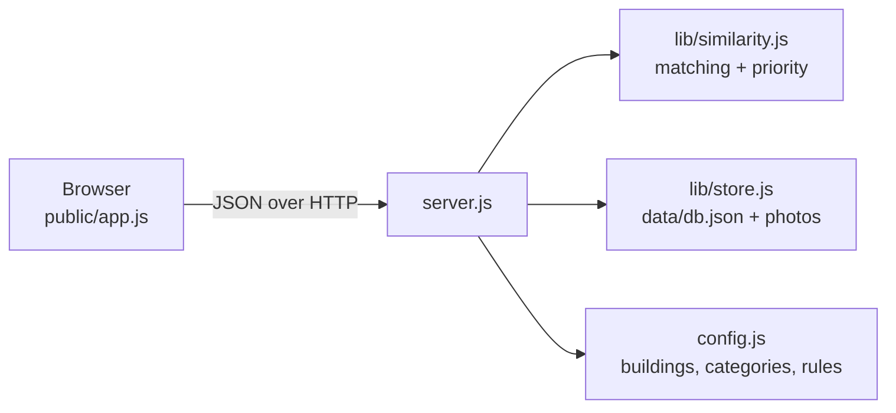

# CampusFix

A campus maintenance reporting app built for the LION Code Challenge, Tech Week 2026 (Penn State Abington).
Students, faculty and staff report broken lights, leaking taps and jammed doors. The app spots duplicate reports, keeps everyone updated, and gives facilities staff a ranked to-do list.

**Team members:** Charlie, Hassan, Anthony

## Run it on your computer

1. Install Node.js (version 18 or newer) from https://nodejs.org
2. In this folder, run:

```
npm start
```

3. Open http://localhost:3000. The terminal also prints an "On your Wi-Fi" address that phones on the same network can open.

There is nothing to install with npm: the app has no dependencies. Run the tests with `npm test`.

Staff view: choose **Staff sign-in** and enter the PIN (default `1234` for local demos; set your own with the `STAFF_PIN` environment variable).

## Features

**Core (required by the brief)**
- Report an issue: title, description, category, campus location, optional photo
- Browse and search by text, category, location and status
- Three status stages with a full history: Reported, In Progress, Resolved
- Duplicate check before submitting. People can add their report to an existing one instead of creating a new ticket.

**What sets it apart**
- **Duplicate detection with reasons.** Combines wording similarity, location, category and a *photo fingerprint*. Each suggestion says why it matched ("Photo looks alike", "Same building", ...) and how strong it is.
- **"Is it fixed?" loop.** When staff mark something Resolved, the people who reported it are asked to confirm. A "no" reopens the issue and raises its priority. This answers the brief's complaint that people never learn whether anything was done.
- **Campus map.** Buildings shaded by open issues, with a pin for every report. Works with the keyboard, and has a plain table as an alternative.
- **QR codes.** `/qr.html` makes printable posters, one per building. Scanning one opens the report form with the location filled in.
- **Staff queue.** Open issues ranked by a score that shows its working (urgent, safety, number of reports, age, reopened) with overdue flags and one-tap Start work / Mark resolved.
- **Safety check.** Words like "exposed wire" or "ice" show a warning with a (sample) campus safety number and flag the issue urgent.
- **Updates.** Each visitor sees staff changes to anything they reported or added their report to.
- **Staff tools.** Delete a single report, clear all reports, reload the sample reports, or export everything as a CSV spreadsheet. Handy for demos and for removing test or inappropriate reports.
- **Dashboard.** Totals, average time to resolve, most-reported buildings, categories, recently fixed, and how many fixes were confirmed or reopened.

## How it works



| File | What it does |
|---|---|
| `config.js` | Every setting: name, buildings, categories, crews, rules |
| `server.js` | The web server and API (about 200 lines, no packages) |
| `lib/similarity.js` | Duplicate matching, category hints, safety words, priority score |
| `lib/store.js` | Saves reports to `data/db.json` and photos to `data/photos/` |
| `public/` | The pages: `index.html`, `app.js`, `style.css`, `qr.html` |
| `test/test.js` | Automated tests (`npm test`) |

**Duplicate matching, step by step.** For a new report we compare it with every open report:
1. *Wording:* count the words each report uses (after dropping filler words, trimming endings, and treating "tap" and "faucet" as the same) and measure the overlap with cosine similarity.
2. *Photo:* the browser shrinks the photo to 9x8 grey pixels and records whether each pixel is brighter than its right neighbour. That gives 64 bits. Photos of the same thing differ in only a few bits, so we count differing bits.
3. *Score:* wording counts most. Same building, room and category only add weight when wording or the photo already links the reports. A similar photo only counts inside the same building.

**Data model.** Each issue: `id, title, description, category, building, room, status, priority, assignee, photo, photoAlt, hash, createdAt, voters[], history[], awaitingConfirm, confirmedFixed, reopened`. Voter ids are random per-browser tokens and never leave the server; the browser only learns whether *it* has voted.

**API.** `GET /api/config`, `GET /api/issues`, `POST /api/analyze` (duplicates and hints), `POST /api/issues`, `POST /api/issues/:id/upvote`, `POST /api/issues/:id/confirm`, and staff-only `POST /api/issues/:id/staff`, `POST /api/issues/:id/delete` and `POST /api/reset`.

## Make it your own

Open `config.js`. Change the app name, the buildings (and where they sit on the map), the categories and their keywords, the crews, the overdue limits and the safety words. Nothing else needs editing. To swap the storage for a real database, replace `lib/store.js`; `server.js` only uses its few methods.

## Put it online (free, about 10 minutes)

This lets anyone with the link use the app from their phone, with no account.

1. **Put the code on GitHub.** Create a new public repository, then upload this whole folder (GitHub's "Add file > Upload files" accepts folders). Do not upload a `data` folder.
2. **Create a Render account** at https://render.com and sign in with GitHub.
3. **New > Web Service**, choose your repository, and set:
   - Runtime: **Node**
   - Build command: `npm install`
   - Start command: `npm start`
   - Instance type: **Free**
4. Under **Environment**, add `STAFF_PIN` with a PIN of your choice (do not leave the default on a public site).
5. Click **Create Web Service**. After a minute or two you get an address like `https://campusfix-xxxx.onrender.com`. Put it at the top of this README and in the submission form.
6. Open `https://your-address/qr.html`, check the address box shows your live link, and print the posters.

(The included `render.yaml` can do steps 3 and 4 automatically: choose **New > Blueprint** instead.)

**Good to know about the free tier:** the app goes to sleep after about 15 minutes without visitors, and the first visit after that takes up to a minute to wake it. Open the link a few minutes before judging. Saved reports and photos are also wiped whenever the app restarts, and the 10 sample reports come back. That suits a demo; for permanent data you would add a database.

## Turn off the sample reports (for real use)

The quickest way: sign in as staff, open **Staff queue**, scroll to **Staff tools** and choose **Clear all reports**. To start empty every time, set the environment variable `SAMPLE_DATA` to `false`. The app then starts with no reports at all.
- On Render: Environment tab, add `SAMPLE_DATA` = `false`, and save. (After a restart the app starts empty.)
- On your computer: `$env:SAMPLE_DATA="false"; node server.js` in PowerShell. Delete the `data` folder first if it already has reports in it.

Before a real launch also change these in `config.js`: `campusName`, `safetyContact` (the real campus safety number), and `footerNote`. For reports to survive restarts you need storage that persists: a Render paid instance with a Disk attached (set `DATA_DIR` to the disk's folder), or a real database in place of `lib/store.js`. The challenge rules require sample data only, so keep sample data on for the contest submission.

## Privacy, accessibility and responsible design

- Sample data only. No accounts, names or emails. Visitors are identified only by a random token stored in their browser.
- Photos are re-saved as JPEG in the browser, which removes hidden data such as GPS location. The form asks people to keep people out of the picture.
- Staff actions need a PIN checked on the server. Writes are rate limited. All text is escaped before display.
- Labelled fields, keyboard access everywhere (including the map), visible focus, status shown in words and not colour alone, alt text for photos, live announcements.
- The category suggestion, safety warning and duplicate matches are suggestions. People always make the final choice.

## Limitations and next steps

- The staff PIN is a single shared PIN. A real deployment would use campus sign-in and separate roles.
- Free hosting does not keep data. A real deployment needs a database and backups.
- Photo matching works for similar angles and lighting, not for a photo taken from the other side of the room.
- The map is a sketch, not real coordinates. Next: real map data, notifications by email or push, and merging duplicates that were filed before matching existed.

## AI disclosure

Built with help from Claude (Anthropic). Add your own notes for the project report on how you read, tested and understood the code (the automated tests in `test/test.js` and manual walkthroughs).
